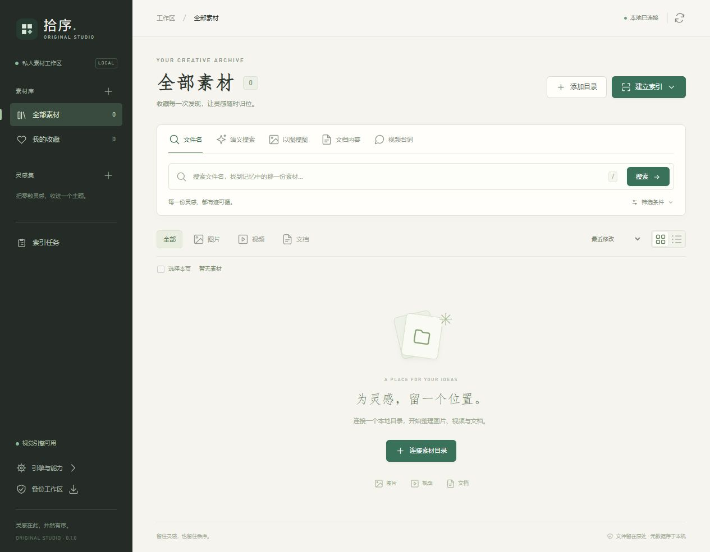

# 拾序 · Original Studio

一个重新编写的本地素材工作台：把图片、视频、文档的搜索与整理放在同一个界面。后端为 FastAPI + SQLite，前端为原生 ES modules，不需要 Node.js 或前端打包。



## 运行

Windows 使用 **Python 3.11（64 位）**。

1. 双击 `install.bat`，安装基础依赖。
2. 需要画面搜索、视频索引或台词检索时，运行 `install-ai.bat`。
3. 双击 `run.bat`，程序会打开本机页面，默认地址为 `http://127.0.0.1:8090/`。
4. 添加素材目录并“扫描素材”。文件名、标签和文档正文可直接搜索；建立视觉索引后可按画面描述/参考图找图片和视频；建立台词索引后可按对白找到时间点。

连接目录时点击“浏览”，会在当前窗口展开本机盘符与子文件夹。点击文件夹进入，使用“上一级目录”返回，最后点击“选择此文件夹”回填路径，再点击“连接目录”。也可直接填写完整路径。目录浏览不依赖后台系统弹窗。

本次工作目录内已准备独立 `.venv` 运行环境。复制源码 ZIP 到其他电脑时，需重新运行安装脚本；ZIP 不包含虚拟环境、模型、素材或索引。

本工作区的 `.env` 将端口设为 **8097**，因为本机 8090 已有服务占用；直接双击 `run.bat` 会使用 8097。源码 ZIP 不包含该机器配置，解压后仍默认使用 8090。

命令行启动：

```powershell
.\.venv\Scripts\python.exe run.py
# 使用另一个本机端口，或单独的数据目录
.\.venv\Scripts\python.exe run.py --port 8097 --data-dir G:/MyStudioData
```

程序使用 Uvicorn 的单进程服务，只监听本机地址。关闭启动窗口或按 Ctrl+C 停止服务。相同数据目录有实例锁，避免两个进程同时调度索引。端口被其他程序占用时，按照启动窗口提示选择另一个端口。

## 主要功能

| 功能 | 使用方式 |
| --- | --- |
| 文件名搜索 | 输入名称、路径、标签或备注关键词；空查询浏览全部素材 |
| 文档正文 | 扫描时建立索引，返回匹配上下文、PDF 页码或字幕时间点 |
| 画面描述 | 中文自然语言搜图与视频画面，支持排除描述和最低相似度 |
| 参考图搜索 | 添加本机参考图，检索相似图片和视频片段 |
| 视频台词 | 本地识别音轨中的语音，按文本检索并跳转到匹配时间点 |
| 整理 | 收藏、标签、备注、多选批量操作和可命名收藏集 |
| 导出 | 收藏集导出 UTF-8 CSV；视频可按起止时间导出 MP4 |
| 任务 | 串行持久队列，显示逐文件失败原因，支持停止、继续和失败重试 |
| 备份 | 创建一致的 SQLite 备份，可从页面下载 |

图片支持 JPEG、PNG、WebP、GIF、BMP、TIFF 等；HEIC/HEIF 使用可选依赖。视频支持 MP4、MOV、MKV、AVI、WebM 等，实际能否解码和在浏览器播放仍取决于具体编码。文档支持 TXT、Markdown、CSV、JSON、YAML、XML/HTML、字幕、DOCX 和有文本层的 PDF。

## 索引方式

“扫描素材”读取元数据、生成缩略图并建立文档正文索引。重复扫描按文件大小和纳秒修改时间判断增量；文件路径不变时保留收藏、标签、备注和集合归属。

“视觉索引”按需加载 Chinese-CLIP。每个视频默认每三秒取一帧，单个视频最多六百帧；长视频会在完整时长内均匀取样。匹配结果给出相邻命中帧的时间范围。相似度是归一化特征的余弦分数乘一百，不是正确率。

“台词索引”按需加载 faster-whisper，默认使用 CPU、int8 与 small 多语言模型。首次建立索引时可能需要联网下载权重，之后可以离线使用。它识别音轨中的语音，不识别画面字幕。文档文字检索也不执行 OCR。

“清理失效索引”移除不可用文件的向量和正文索引，保留路径和整理记录。它不删除原始素材。移走或重命名文件会产生新的路径身份，当前版本不自动迁移旧路径的标签。去重与自动目录监听尚未包含。

任务停止在文件/视频帧/语音片段边界生效。模型下载和加载不能立即中断。意外退出后，原运行任务显示“已中断”，可点击继续。已处理文件保持结果；下一次新扫描会检查其间发生的文件变化。

文档最大读取 64 MiB、正文最多五百万字符、PDF 最多两千页；截断和无文本层状态保存在素材详情。缩略图和参考图均为程序生成的预览。

## 模型与离线配置

将 `.env.example` 复制为 `.env` 后按需调整。常用选项：

```dotenv
ORIGINALSTUDIO_PORT=8090
ORIGINALSTUDIO_MODEL=OFA-Sys/chinese-clip-vit-base-patch16
ORIGINALSTUDIO_DEVICE=cpu
ORIGINALSTUDIO_WHISPER=small
ORIGINALSTUDIO_OFFLINE=false
```

`ORIGINALSTUDIO_MODEL` 也可以是完整的本地 Hugging Face 模型目录。若 `data/models/vision/config.json` 存在，未配置模型名称时会自动使用该本地目录；本次工作区已放置可用的第三方图文权重。更换模型后重新建立视觉索引，程序只检索与当前模型签名一致的向量。

离线机器需要先准备完整模型和依赖，再设置 `ORIGINALSTUDIO_OFFLINE=true`。语音模型可以设置为本地 CTranslate2 模型目录。模型和依赖的来源见 [第三方说明](THIRD_PARTY_NOTICES.md)。图文适配器按 [Transformers Chinese-CLIP 文档](https://huggingface.co/docs/transformers/v4.41.2/en/model_doc/chinese_clip)实现；语音接口使用 [faster-whisper](https://github.com/SYSTRAN/faster-whisper)。

如果 `data/models/speech/model.bin` 存在且未设置 `ORIGINALSTUDIO_WHISPER`，默认使用这个本地语音模型目录。

安装 AI 依赖后，`imageio-ffmpeg` 会提供片段导出所需的本机 FFmpeg 程序，也可使用 `bin/ffmpeg.exe` 或 PATH 中的版本。该包提供平台执行程序的方式见[项目说明](https://github.com/imageio/imageio-ffmpeg)。生成的片段保存在数据目录的 `exports/` 下，原视频只读取。

## 数据与恢复

源码运行默认保存在项目 `data/`；打包运行默认保存在 `%LOCALAPPDATA%/OriginalStudio`。可通过 `--data-dir` 或 `ORIGINALSTUDIO_DATA` 指定另一个位置。

```text
data/
  workspace.sqlite3   素材、整理资料、正文、向量、任务记录
  thumbnails/         缩略图
  references/         重新编码后的参考图
  exports/            导出的视频片段
  backups/            用户创建的数据库备份
  models/             模型缓存
  logs/               按大小轮转的运行日志
```

恢复备份：关闭程序，先复制当前数据目录保留现场，然后在一个新的空数据目录中把下载的备份命名为 `workspace.sqlite3`，使用 `run.py --data-dir 新目录` 启动。原素材路径有效时可以继续使用整理数据；缩略图可通过扫描重建。模型缓存可以另行复制。不要把备份覆盖到正在运行的数据库或混用其他数据库的 WAL/SHM 文件。

## 源码结构

```text
originalstudio/
  api.py                  应用装配、生命周期、错误响应
  routes_*.py             素材、集合、任务接口
  security.py / paths.py  本机请求与真实路径校验
  storage.py              版本化 SQLite 结构与一致备份
  repository.py           素材、整理与集合事务
  jobs.py / indexing.py   持久任务与逐文件索引
  search.py               中文全文、图文和视频片段匹配
  documents.py / media.py 文档提取与媒体处理
  engines.py              延迟加载的模型适配器
static/                   新界面，无 CDN 或构建步骤
tests/                    临时文件与数据库验证
docs/                     API、设计、验证记录
```

正文索引采用 [SQLite FTS5 trigram](https://www.sqlite.org/fts5.html#the_trigram_tokenizer)，一到两个字符的中文查询使用转义的包含匹配。目录和日期、类型、标签、收藏及集合可以组合筛选。当前向量搜索为按批计算余弦相似度，适合单机资料库，尚未做十万级或百万级性能承诺。

## 开发验证与打包

```powershell
.\.venv\Scripts\python.exe -m pip install -r requirements-dev.txt
.\.venv\Scripts\python.exe -m unittest discover -s tests -v
# 安装 Node.js 时可额外检查界面模块语法
Get-ChildItem static/*.js | ForEach-Object { node --check $_.FullName }
# 可选：生成 Windows 目录版，IncludeAI 会包含较大的推理依赖
.\build_windows.ps1
.\build_windows.ps1 -IncludeAI -ModelPath G:/Models/chinese-clip
# 仅打包源码
.\.venv\Scripts\python.exe tools/package_source.py
```

实际检查结果与未覆盖的交付验证写在 [验证记录](docs/verification.md)。Windows 打包脚本提供目录版构建入口；跨机器安装、签名和升级安装器需要单独验证。

`requirements-lock.txt` 记录本次 Python 3.11 / Windows 环境实际安装的完整版本，含 CPU 推理与开发依赖。需要完整复现时可在新的虚拟环境中运行 `python -m pip install -r requirements-lock.txt`；日常安装仍按基础与 AI 两个安装脚本分步进行。
