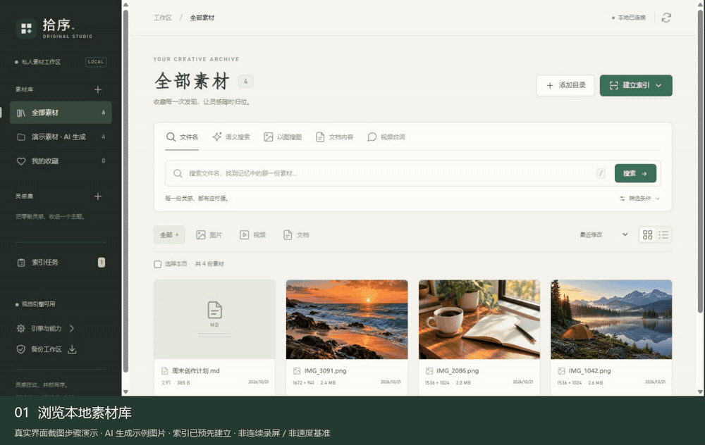

# Original Studio · 拾序

**Find local images, video moments, and documents from the clues you remember.**

[中文](README.md) · [Download](https://github.com/LEAFSSSSS/OriginalStudio/releases/latest) · [Report an issue](https://github.com/LEAFSSSSS/OriginalStudio/issues)

Original Studio is a Chinese-first desktop asset workspace served through a local browser interface. Search filenames, describe a scene in Chinese, upload a reference image, find document passages, or locate spoken dialogue in a video.

[](https://github.com/LEAFSSSSS/OriginalStudio/releases/download/v0.1.1/OriginalStudio-demo.mp4)

[Watch MP4](https://github.com/LEAFSSSSS/OriginalStudio/releases/download/v0.1.1/OriginalStudio-demo.mp4) · [Download sample materials](https://github.com/LEAFSSSSS/OriginalStudio/releases/download/v0.1.1/OriginalStudio-demo-materials.zip) · [Demo details and prompts](docs/demo.md)

<sub>A sequence of actual UI screenshots, not a continuous screen recording. Sample images are AI-generated and indexes were prepared beforehand. Playback duration does not represent processing speed.</sub>

> **Early preview, v0.1.1.** The current release is source code for Windows with Python 3.11, 64-bit. The interface is in Chinese. An EXE installer and clean-machine installation have not been validated.

## Features

| Search or organize | How it works |
| --- | --- |
| Filenames, tags, notes | Browse and filter local assets |
| Chinese scene descriptions | Chinese-CLIP features for images and sampled video frames |
| Reference images | Similar image and video-moment retrieval |
| Document content | Text passages with page or subtitle positions |
| Video dialogue | Local faster-whisper transcription with timestamps |
| Collections | Favorites, tags, notes, collections, CSV exports, and video clips |

Files stay in their existing folders. Metadata and indexes are stored in a local SQLite database. AI models load on demand and inference runs locally. Dependency and model downloads need internet access the first time.

## Quick start on Windows

Install **Python 3.11, 64-bit**. Download and extract `OriginalStudio-source.zip` from [Releases](https://github.com/LEAFSSSSS/OriginalStudio/releases/latest), or clone the repository:

```powershell
git clone https://github.com/LEAFSSSSS/OriginalStudio.git
cd OriginalStudio
.\install.bat
.\install-ai.bat   # Optional: visual search, video processing, speech
.\run.bat
```

The app opens `http://127.0.0.1:8090/` and listens only on the local machine. For an occupied port, run `run.bat --port 8097`.

1. Click **添加目录** (add directory), then **浏览** (browse).
2. Navigate to a folder and click **选择此文件夹** (use this folder), then **连接目录** (connect).
3. Scan the folder for filenames, previews, and document text.
4. Build a **视觉索引** (visual index) for semantic/reference-image search, or a **台词索引** (dialogue index) for spoken text.

The release does not include a virtual environment, model weights, or user files. Install dependencies and let the app download models, or configure complete local model directories for offline use.

To try the sample, download the materials ZIP above, connect its `materials` folder, scan it, and build a visual index. Select **语义搜索** and search **湖边的帐篷** (a tent beside a lake), or select **文档内容** and search **露营** (camping). Open a result to add favorites, tags, notes, and a collection.

## Current limits

- Documents require extractable text; OCR is not included.
- Dialogue indexing recognizes audio, not subtitles drawn into video frames.
- Video playback depends on the source codec.
- Renamed/moved paths do not inherit annotations automatically.
- Large-library benchmarks, GPU configurations, and other operating systems have not been validated.

## Documentation and contribution

[Usage and model configuration, Chinese](docs/usage.md) · [API contract](docs/api.md) · [Changelog](CHANGELOG.md) · [Contributing](CONTRIBUTING.md) · [Verification record](docs/verification.md)

If the project is useful, a Star helps other people discover it. Bug reports, concrete use cases, documentation improvements, and focused pull requests are welcome.

## License

Copyright © 2026 LEAFSSSSS. Application code is licensed under **GNU GPL v3.0, GPL-3.0-only**. See [LICENSE](LICENSE) and [third-party notices](THIRD_PARTY_NOTICES.md) for dependencies and model sources.
